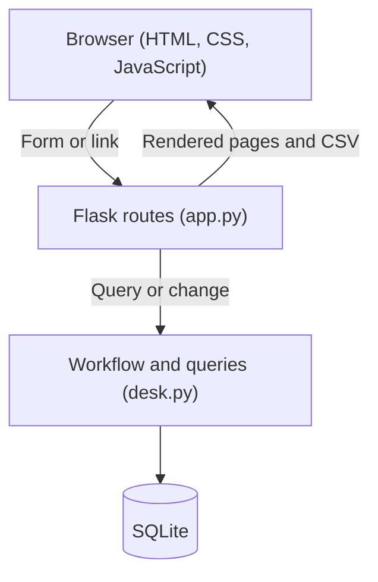

# Campus Service Desk

A campus help-desk application for reporting everyday issues, tracking each request, and exporting a filtered work queue. Built as a software engineering portfolio project using Python, Flask, SQLite, HTML, CSS, and vanilla JavaScript.

**[Open the live portfolio preview](https://campus-service-desk-six.vercel.app)**

The preview includes 12 fictional tickets across five campus service categories. Choose **[Try the demo](https://campus-service-desk-six.vercel.app/demo)** to create requests, update statuses, and inspect the history in a private copy of that queue. Changes are kept in the current tab’s session storage and survive refresh. Reset the demo to restore the sample queue. The local staff app uses persistent SQLite storage.

## Try it locally

You need Python 3.11 or newer. Open a terminal in this project folder.

```bash
python -m venv .venv
```

Activate the environment with `.venv\Scripts\Activate.ps1` in Windows PowerShell or `source .venv/bin/activate` on macOS/Linux. Then run:

```bash
python -m pip install -r requirements.txt
python -m flask --app app seed
python -m flask --app app create-staff you@example.com
python -m flask --app app run
```

Choose a password of at least 12 characters when prompted. Sign in with this email and password.

Open [http://127.0.0.1:5000](http://127.0.0.1:5000). Skip the seed command to start with an empty dashboard. Seeding only populates an empty database, so rerunning it preserves existing requests.

### Five-minute walkthrough

1. Submit a request titled **Broken keyboard in Lab 3** under **IT Support** with a short description.
2. Copy its tracking reference, return to the dashboard, and search for it.
3. Open the request, move it to **In progress**, and add a note. Resolve it and check that both updates appear in the history.
4. Filter the dashboard by **Resolved** and export the matching requests as CSV.

## How it works



When you submit a request, Flask checks the form and asks SQLite to save the ticket and its first history entry together. Flask then redirects you to the ticket page. On that page, the app reads the ticket and its history from SQLite and inserts them into an HTML template.

SQLite has two tables. **tickets** holds the current state of each request. **events** holds its submission and status changes, with many events linked to one ticket. The local database is a file at `instance/desk.sqlite3`, so requests survive application restarts. Set `CSD_DATABASE` to use a different file.

| Path | Job |
| --- | --- |
| `app.py` | Receives browser requests, validates inputs, renders pages, and builds CSV files |
| `desk.py` | Defines the schema, sample data, filtering query, and allowed status changes |
| `templates/` | Contains the HTML layouts and screens |
| `public/assets/` | Styles the interface and adds copy-to-clipboard and a character counter |
| `tests/test_app.py` | Exercises Flask routes with isolated SQLite databases |
| `.github/workflows/tests.yml` | Runs the test suite on pushes and pull requests using Python 3.11 and 3.12 |

### Engineering decisions

- **Status changes leave a history.** Open requests can move to In progress, and in-progress requests can be resolved or sent back to Open. Resolved requests can be reopened. Each change updates the ticket and adds an event in one transaction.
- **Stale pages cannot overwrite newer changes.** Each status form carries the latest event ID. If another update already happened, Flask shows the newer history and asks the visitor to review it.
- **Exports match the dashboard.** Both screens use the same query for title or reference search and for status, category, and priority filters. CSV cells that could be interpreted as formulas are prefixed with an apostrophe.
- **Core actions work through HTML forms.** JavaScript adds the character counter and copy button. Submission, filtering, status updates, and download are handled by Flask.

## Tests

```bash
python -m unittest discover -s tests -v
```

The suite covers ticket creation and restart persistence, input validation, status transitions and history, stale updates, shared filters and CSV output, HTML escaping, form-token checks, sample data, and the hosted preview's write restrictions.

## Deployment and scope

Local staff sign in to a shared queue. Staff passwords are stored as salted hashes. A signed session cookie identifies the signed-in user. Set a stable random CSD_SECRET_KEY for shared deployments. The public visitor account is available only in the read-only preview. Use fictional request details.

On Vercel, the app uses an in-memory SQLite database seeded with the same fictional records on each request. This makes the public preview repeatable across serverless instances. Visitors can browse, filter, inspect ticket history, and download CSV. The shared preview stays read-only. The interactive demo edits a tab-local copy of the seed tickets, using the same status transitions as the staff workflow. To preview the same mode locally, set `CSD_READ_ONLY=1` before starting Flask.

## Campus photography

The dashboard and sign-in share a wide photograph of the [Bishop Tucker Building by Ssemmanda will](https://commons.wikimedia.org/wiki/File:The_Bishop_Tucker_Building_-_UCU_Mukono_06.jpg). The original is 8,256 × 4,528 pixels. Responsive crops and WebP renditions are distributed under [CC BY-SA 4.0](https://creativecommons.org/licenses/by-sa/4.0/). This portfolio project is independent of the university.
